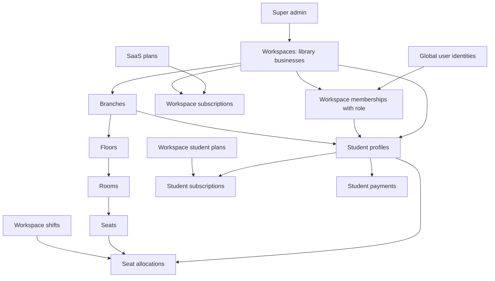

# Backend and table review — 8 October 2026

Status: the user approved implementation. The first authentication, isolation, and integrity stage is implemented in the working tree; see IMPLEMENTATION_NOTES.md for scope, migration instructions, and remaining stages. The database has not been migrated. Findings below describe the original review baseline.

Reviewed the 22 Sequelize models, API routes and controllers, authentication and tenant middleware, core services, scheduled jobs, and architecture migration script. Findings concern the checked-out source. The deployed database, frontend contracts, and live payment configuration were not inspected. Existing work in the checkout was not edited.

## 1. Keep the existing foundation

Use one workspace as the boundary for one library business. Branches represent its physical locations. The user confirmed that one owner can manage multiple libraries and the same student can join libraries belonging to different owners. The proposed design therefore separates global login identity from workspace membership. A super admin is a platform role; owner, manager, staff, and student permissions belong to the selected workspace membership. Separate identity tables for each role are unnecessary.

This diagram describes the proposed main relationships, including the new workspace memberships. Currently a user has only one workspace and there is no membership table. Allocations and payments also lack a direct link to the exact student subscription. SaaS billing is separate for each workspace, as confirmed by the user.

Keep `saas_plans` / `workspace_subscriptions` separate from `subscription_plans` / `student_subscriptions`. The former describe an owner's purchase from the platform; the latter describe a student's purchase from a library. Their money, access rules, and histories must remain separate.

## 2. Highest-priority findings

### A. Workspace isolation is incomplete

- `src/services/student.service.ts:101` loads a student by ID without caller ownership; the corresponding routes also allow students. Update, delete, status, and dues operations have similar gaps. Student updates include password and approval-status changes without sufficient caller restrictions.
- `src/services/workspace.service.ts:111` and related controller methods receive resource IDs without authenticated workspace context. Routes such as `/workspaces/:id` are not protected by middleware checks for a parameter named `workspaceId`.
- Workspace and seat routers mount `tenantIsolation` using `router.use` before their individual routes. At that layer, the later route's parameters are not available. Injecting a workspace ID into the body does not protect services that use the original path ID directly.
- Related IDs are not consistently checked together: student, branch, plan, shift, and seat must all belong to the authorized workspace. Individual foreign keys do not express that combined rule.
- Attendance, complaints, books, and payment operations also have missing ownership checks. Student payment listings can include other students in the same workspace.
- `AuthService.updateProfile` lets any authenticated user with a workspace update workspace details. The route has no owner-only restriction.

Proposed change: pass trusted caller context into services, scope resource lookups to the workspace, resolve seat ownership through room/floor/branch, restrict student operations to their own profile and allowed fields, and derive actor IDs from authentication. Add database constraints for compatible tenant relationships after checking existing data. Owners must not be able to modify platform-controlled fields such as workspace suspension.

### B. Authentication and payment shortcuts permit bypasses

- `src/services/auth.service.ts:103`: OTP verification accepts a fixed code.
- `src/services/auth.service.ts:242`: a mock Google-token path accepts decoded JSON without verifying a Google signature. The regular path also lacks explicit expected-audience validation.
- Auth code contains a fallback JWT secret. Access and refresh tokens are not distinguished during authentication.
- `src/services/payment.service.ts:155` and `src/services/workspace.service.ts:388`: signature verification is conditional; omitting signature fields skips it.
- SaaS order creation does not persist the order-to-workspace/plan/amount relationship. Verification accepts a plan ID from the request.
- Student verification does not bind the supplied order to the stored order, and repeated verification can create additional student subscriptions.
- Students may call payment creation with `CASH`, which immediately marks money collected and can activate a subscription.
- Provider order creation errors fall back to a fabricated student-payment order. Source also contains fallback payment credentials; their validity was not checked.

Proposed change: remove reachable authentication/payment mocks, require verified provider evidence tied to a stored order, restrict manual collection to authorized staff, and make repeated callbacks produce one business result. Use explicit production secrets. Review the Git-tracked Firebase credential file without exposing its contents; rotate any real credentials that have been exposed.

### C. Model requirements and write paths disagree

- `AttendanceService.checkIn` omits required `workspaceId` and `branchId` on creation.
- `ComplaintService.createComplaint` omits those same required fields.
- `LibraryService.issueBook` and `requestBook` omit required `workspaceId`.

With these model definitions, the create operations should fail validation. Populate these values from an authorized parent record, then test against an isolated PostgreSQL database.

### D. Seat operations can affect other students or conflict

- `src/controllers/seat.controller.ts:176`: after checking a student's own allocation, the controller calls `vacateSeat` without the student's ID. The service consequently deactivates every active allocation on that seat, including other shifts/students.
- Allocation and transfer perform check-then-write operations without transactions or a database rule preventing conflicting allocations. Concurrent requests can both see an available seat.
- Conflict checks use shift IDs and `isActive`, without comparing booking date ranges or overlapping times of different shifts.
- `SeatService.updateAllocation` edits the student's latest subscription, which may be unrelated to that allocation.
- Seat expiry processing scans across all workspaces during certain ordinary seat requests.

Proposed change: fix student-scoped vacating first; transact allocation/transfer; link allocations to the exact subscription; define conflict rules for date ranges, overnight shifts, and clubbed shifts. Treat availability as a property of the requested shift and dates, while preserving the existing API representation during migration.

### E. Multi-record operations can leave partial state

Owner onboarding, student admission, payment/subscription creation, dues collection, book inventory changes, and seat transfers lack consistent database transactions. A later failure can leave earlier writes committed. Student branch updates change the profile's branch but not the user's duplicate branch field.

Proposed change: atomic database transactions for related local writes, row locking or equivalent concurrency protection for balances and inventory, and explicit synchronization rules for duplicated fields. Keep external payment calls outside long-lived database transactions and persist their pending/success/failure states.

## 3. Table changes worth making

| Area | Proposed minimum change | Reason |
|---|---|---|
| Login identity and membership | Keep `users` for login; add `workspace_memberships(userId, workspaceId, role, status)` with one membership per user/workspace initially | One owner or student can belong to multiple libraries without duplicate credentials |
| Student profiles | Link each profile to its student membership; replace global `userId` uniqueness with one profile per user/workspace | Each library retains independent admissions, dues, subscriptions, attendance, and guardian details |
| Branch assignments | Add `membership_branches(membershipId, branchId)` for the confirmed assigned-branch access policy | Staff can be assigned to one or more branches without gaining access to every branch |
| Workspace subscriptions | Choose one current subscription per workspace; enforce that invariant and record renewal history separately | Current code mixes unordered `findOne` with selecting the newest row; concurrent trial starts can create duplicates |
| Platform payments | Add `saas_payments` with workspace, subscription, plan, amount, currency, provider order/payment IDs, status, and timestamps | Store and verify the owner's actual purchase; preserve renewals and prevent replay |
| SaaS plans | Add an explicit billing duration and save purchased price/limits with the subscription/order | Activation currently hardcodes 30 days; changing a catalog plan should not rewrite historical terms |
| Student charges | Add `student_invoices` with subscription, agreed price, discount, total, due date, and status | A single mutable `dueAmount` cannot explain what was charged or discounted |
| Student payments | Link collections to an invoice; store provider order and payment IDs separately with appropriate uniqueness | Support partial collections and reliable verification; retain existing payment IDs |
| Seat allocations | Add `studentSubscriptionId`; enforce the agreed concurrency/date conflict rules | Stop updating an unrelated latest subscription |
| Tenant relationships | Add targeted composite keys/foreign keys and scoped indexes where appropriate | Prevent records from referring to parents belonging to different workspaces |
| Audit history | Add a small `audit_logs` table for privileged changes, with workspace, actor, action, entity, timestamp, and redacted change details | Explain who changed approvals, balances, subscriptions, or suspension |

Start with one invoice per student subscription and many payments per invoice if that matches the business. If one payment can settle several invoices, add an allocation table then. Do not invent historical invoice amounts from today's plan prices: mark uncertain legacy records for reconciliation.

Further normalization can wait:

- Consolidate pricing currently split between shift price columns, `customPricing`, and dynamically generated subscription plans. Prefer one authoritative plan catalog with shift association and explicit duration; snapshot purchased terms. Current admission lookup includes price but the plan-name uniqueness constraint does not, so a price change can cause a duplicate-name failure.
- Replace `shifts.baseShiftIds` JSON with a membership table if clubbed shifts are actively used, to validate component ownership and prevent invalid references.
- Store custom WhatsApp templates per workspace in a table. They are currently global process memory, shared across workspaces and lost on restart.
- Workspace membership is now required, not a deferred optional enhancement. Retain a unique verified login identity; remove the global admission rejection when that identity already belongs to another workspace. Joining an existing identity must use verified account ownership or an invitation/claim flow: an owner must not change another user's global password or discover their memberships elsewhere. Workspace selection must validate active membership on every request. Migrate legacy user role/workspace/branch fields into memberships before switching authorization and eventually retiring those fields. Store library-managed student details in the library profile rather than letting one owner overwrite a global identity. A single membership role is the initial proposal; simultaneous roles within one workspace would need an explicit role-assignment design.
- Decide whether students require app login. If owners need records for students without accounts, make enrollment independent of login through a staged migration; stop creating shared-default-password accounts and synthetic emails for every admission.

## 4. Subscription governance and reporting

`tenantIsolation` checks workspace suspension but does not check subscription expiry. The scheduled job expires trials only; paid subscription expiry and `maxSeats` enforcement are absent from the inspected operational code. Super-admin-created workspaces get a 14-day trial, while the explicit trial endpoint defaults to 7 days and accepts the requested number of days. Self-registration/setup paths do not create the same subscription records.

Confirmed expiry policy: at the subscription expiry timestamp, ordinary library operations become read-only for exactly 24 elapsed hours. At expiry plus 24 hours, block ordinary library reads and writes. Do not delete records. This applies to the affected library, without disabling a shared user account or blocking that user's other active libraries. Keep authentication, library selection, subscription status, and renewal/payment verification available so the owner can recover access.

Only the super admin can grant or change a dated grace override and choose either read-only or full access for its duration, as confirmed by the user. Record the granting admin, reason, access mode, and deadline. Owners, managers, staff, and students cannot grant grace or change its mode/deadline. Full access during grace restores subscription entitlement but does not bypass workspace membership, role permissions, or assigned-branch restrictions. Proposed behavior after a grace deadline is to return to the original expiry timeline, not automatically grant a fresh 24 hours. Manual super-admin suspension takes precedence over ordinary subscription/grace access; only an explicit administrative action should lift it. These precedence rules are proposals, not yet implemented.

Derive effective access at request time from subscription dates and any valid override, independently of scheduled status updates. Read-only enforcement must classify business operations: some existing GET handlers write settings or expire allocations, so simply blocking POST/PATCH/DELETE is insufficient. Define background notification and operational-job behavior under expired subscriptions as part of implementation. Test exact expiry/24-hour/grace boundaries, renewal from blocked state, override authorization, and isolation between libraries.

Use one onboarding workflow and one server-controlled trial policy. Check plan seat limits during seat creation and define downgrade behavior. The user confirmed this is development with Razorpay test credentials; retain real verification for test-mode orders, using sandbox transactions for end-to-end checks rather than accepting fabricated proof.

Financial reports currently sum `PAID` rows and omit money already collected in `PARTIAL` rows. Dashboard dues use `UNPAID` payment amounts, while the profile maintains another balance. Revenue trends and platform uptime contain mock values. Manual payment confirmation does not activate subscriptions like cash creation/online verification do. These need one consistent collection/entitlement workflow and real report queries.

## 5. Deletion, migration, and other integrity issues

- `src/services/workspace.service.ts:229` contains malformed SQL: `DELETE FROM  WHERE ...`. It catches and ignores the error inside the transaction. Workspace deletion needs an explicit archive-versus-permanent-purge policy before repair.
- Student deletion soft-deletes the profile/user but does not release allocations. Reports that join only nondeleted students can then omit their historical collections. Keep financial history reportable and make cleanup explicit.
- The architecture script ends in `sync({ alter: true })`; startup also runs schema operations by default. Replace production schema evolution with versioned, reviewed migrations and explicit backfill/validation steps.
- Attendance currently assumes one visit per UTC date; confirm whether multiple visits and library-local dates are required before adding uniqueness rules.
- Add a global safe serialization policy: several returned `User` associations and admission/update results include the password hash field.
- Validate and whitelist request fields, monetary amounts, dates, pagination, and status transitions. The public upload route needs authentication and storage limits appropriate to the service.

## 6. Implementation sequence and acceptance checks

1. **Protect access and repair existing flows:** auth/payment verification, tenant/role checks, required ownership fields, student-scoped vacating, safe response serialization. Main files: `src/middlewares/*`, affected routes/controllers, and `src/services/{auth,workspace,student,payment,seat,attendance,complaint,library}.service.ts`.
2. **Make writes reliable:** transactions, duplicate-callback protection, subscription/seat linkage, consistent collection and balance behavior. Add regression tests using two unrelated workspaces and multiple students/shifts.
3. **Introduce missing billing records:** additive model changes and versioned migrations; backfill only unambiguous relationships; reconcile legacy balances; preserve current API contracts while frontend compatibility is checked.
4. **Apply confirmed business rules:** migrate to workspace memberships, implement the 24-hour read-only expiry policy and audited grace overrides, enforce assigned-branch access for managers/staff and separate SaaS billing per workspace. Membership design must be settled before authorization changes in step 1; its migration can be staged with compatibility support. Trial policy and pricing normalization remain explicit design decisions.

Required regression scenarios include cross-workspace reads/writes being rejected; student self-access limits; invalid or missing payment proof being rejected; one activation after repeated verification; simultaneous seat requests producing one winner; vacating one student's shift preserving another's; transactional rollback on partial admission/payment failure; partial collections reconciling with dues; expired SaaS access following the agreed policy; and existing frontend payloads remaining compatible.

Use a backup and isolated copy of the database to inspect actual constraints and rehearse migrations. Keep old columns until backfills, reconciliation, and application compatibility checks pass. A guarantee that nothing breaks cannot be established from source review alone.

## 7. Verification completed

- `tsc --noEmit --incremental false`: passed.
- `npm test -- --runInBand --watchman=false`: 6 passed, 3 failed in the sole test suite, `src/config/database-options.spec.ts`.
- All three failures expect TLS certificate verification to be enabled; current configuration sets `rejectUnauthorized: false`.
- The first Jest attempt was blocked by local Watchman permissions; disabling Watchman allowed the suite to run.
- No server startup, migrations, live database queries, payment requests, or outgoing notifications were run.

## 8. Confirmed requirements and remaining decisions

Confirmed by the user:

1. One owner can manage multiple libraries; a student can join libraries belonging to different owners.
2. The backend is in development and uses Razorpay test credentials. This does not authorize deleting development data or bypassing payment verification.
3. Subscription expiry gives 24 hours of read-only access followed by blocked library access. The super admin can grant additional grace time.
4. Each library/workspace has its own SaaS subscription, even when the same owner manages several libraries.
5. Managers and staff can access only their assigned branches. Branch assignments must belong to their workspace, and this restriction applies to reads, writes, reports, and broadcasts.

6. Only the super admin can grant grace and choose read-only or full access for the grace period. All ordinary role, workspace, and branch restrictions still apply.

The requested membership, billing-scope, branch-access, and grace-mode decisions are now confirmed.

The user approved starting implementation. See IMPLEMENTATION_NOTES.md for delivered changes and delivered membership/subscription-access changes and remaining follow-up items.

Recommendation: keep the current Express/Sequelize/PostgreSQL application and improve it in these stages. The described requirements do not currently justify a rewrite, separate databases for every library, or additional infrastructure.
